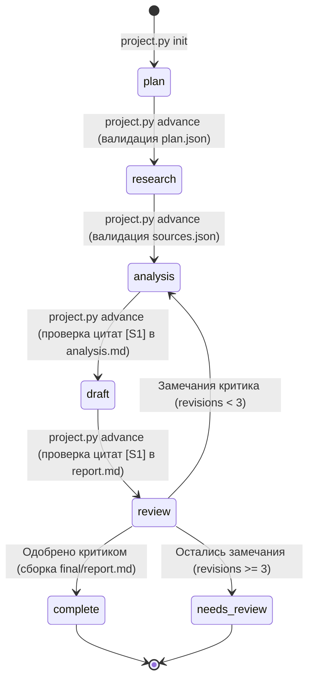

<div align="center">

# 🦉 Сова (Sova)

**Агентская система для академических исследований, разбора университетских кейсов и продвинутых задач Excel с верификацией формул внутри Codex, Claude Code и Antigravity**

[](https://www.python.org/)
[-2ea44f.svg?style=for-the-badge)](./install.py)
[](./LICENSE)
[](./skill/sova/SKILL.md)

*Исследования и учебные задания внутри **Codex, Claude Code и Antigravity** — без отдельных API-ключей, OpenRouter, Tavily, LangGraph и сервера. Модели и инструменты предоставляет приложение, в котором открыт проект.*

[Быстрый старт и вызов](#-вызов-по-названию) •
[Установка в проект](#-добавление-в-другой-проект) •
[Архитектура исследования](#-что-происходит-после-задания) •
[Продвинутый Excel](#-продвинутый-excel) •
[Возможности и границы](#-возможности-и-границы) •
[Проверка пакета](#-проверка-пакета)

</div>

---

## 🚀 Вызов по названию

После личной установки достаточно написать в любом проекте:

> Сова, исследуй международную стратегию LEGO и подготовь отчёт с источниками.

Также: «Используй Сову для анализа…» или «Запусти Сову: …».
Первый раз после установки начните новый чат или обновите список skills.

### Личная установка сразу в три приложения

```sh
git clone https://github.com/Co4an/sova.git
cd sova
python3 install.py --personal --app all
```

Устанавливаются только папки skill:
- `~/.codex/skills/sova` (Codex)
- `~/.claude/skills/sova` (Claude Code)
- `~/.gemini/config/skills/sova` (Antigravity)

Сам skill распознаёт имя системы и начинает работу без `START_HERE.md`. Обнаружение и выбор skill выполняет приложение; если его политика отключила automatic skills, явный вызов `$sova` в Codex или `/sova` в Claude Code позволяет проверить доступность.

---

## 📦 Использование переносимой папки

Откройте папку этого репозитория в нужном приложении и отправьте:

> Прочитай START_HERE.md и выполни исследование: [ваше задание]. Работай автономно.

Папка уже содержит skill в [`.agents/skills/sova`](./.agents/skills/sova/SKILL.md) и [`.claude/skills/sova`](./.claude/skills/sova/SKILL.md). При необходимости начните новый чат или обновите список skills. Явное чтение [`START_HERE.md`](./START_HERE.md) работает и без автообнаружения.

В Codex также можно вызвать `$sova`, в Claude Code — `/sova`. В Antigravity попросите использовать skill `sova` (Сова).

---

## 🔧 Добавление в другой проект

Передайте агенту путь к этому пакету и попросите:

> Установи Сова из этой папки в текущий проект через install.py.

Либо из папки пакета выполните одну команду с рабочим Python 3.10+:

```sh
python3 install.py --target "/путь/к/проекту" --app all
```

Можно выбрать `--app codex`, `claude` или `antigravity`. Установка локальная, не требует `pip`, сети, ключей или изменения глобальных настроек. Существующий отличающийся skill не перезаписывается; повторная идентичная установка безопасна. Без Python можно скопировать `skill/sova` в указанную ниже папку. Если системный Python на macOS требует Xcode, агент может использовать Python своей среды. Для ручного ведения файлов Python не нужен.

| Среда | Локальная папка в проекте | Личная установка (`--personal`) |
| :--- | :--- | :--- |
| **Codex** | `.agents/skills/sova/` | `~/.codex/skills/sova/` |
| **Claude Code** | `.claude/skills/sova/` | `~/.claude/skills/sova/` |
| **Antigravity** | `.agents/skills/sova/` | `~/.gemini/config/skills/sova/` |

Форматы сверены с официальной документацией:
[Codex Skills](https://learn.chatgpt.com/docs/build-skills),
[Claude Code Skills](https://code.claude.com/docs/en/skills),
[Antigravity Skills](https://antigravity.google/docs/skills?app=antigravity-ide).
Для старых версий Antigravity может использоваться `.agent/skills/`; явное чтение `START_HERE.md` остаётся запасным способом.

---

## 🏛 Что происходит после задания

Агент разбирает требования, распределяет исследовательские вопросы, собирает источники штатным поиском приложения, анализирует данные, пишет отчёт и передаёт его критику. При наличии штатных субагентов исследования выполняются параллельно; при их отсутствии используются последовательные проходы по ролям.



### Роли и артефакты

| Роль | Вход | Выход |
| :--- | :--- | :--- |
| **Planner** | Задание и критерии (`assignment.md`) | Требования и исследовательские вопросы (`plan.json`) |
| **Web / Academic / Data Researchers** | Отдельный вопрос из плана | Первоисточники с точными выдержками, датами и страницами (`research/<task-id>.md`, `sources.json`) |
| **Analyst** | Собранные доказательства | Аргументация, альтернативные объяснения и воспроизводимые расчёты (`analysis.md`) |
| **Writer** | Требования и анализ | Черновик отчёта со ссылками `[S1]`, `[S2]` (`report.md`) |
| **Critic** | Задание, источники, анализ и черновик | Независимая проверка покрытия требований и существенных проблем (`review.json`) |

В `research/<имя-проекта>/` сохраняются:
- задание (`assignment.md`), план и критерии (`plan.json`);
- источники с выдержками и страницами (`sources.json`);
- исследовательские заметки и расчёты (`research/`);
- анализ (`analysis.md`), черновик (`report.md`) и замечания критика (`review.json`);
- состояние для продолжения (`state.json`) и финальный Markdown с библиографией (`final/report.md`).

Не более трёх доработок. Если существенные замечания остались, результат получает статус `needs_review`. Для продолжения в другом приложении откройте тот же проект и напишите: «Используй sova и продолжи research/<имя-проекта>». Одновременно менять один research-проект из разных приложений не следует.

### Локальные команды управления этапом

```sh
python3 skill/sova/scripts/project.py init research/my-study --task "Задание"
python3 skill/sova/scripts/project.py status research/my-study
python3 skill/sova/scripts/project.py check research/my-study
python3 skill/sova/scripts/project.py advance research/my-study
```

---

## 📊 Продвинутый Excel

Вызов:
> Сова, выполни задание в Excel и проверь формулы.

Skill подключает профиль [`references/excel.md`](./skill/sova/references/excel.md):
1. **Требования (`excel-requirements.md`)** → отображение каждого пункта задания на лист/диапазон или нативный объект.
2. **Формулы и объекты** → реальные редактируемые формулы Excel (`SUMIFS`, `XLOOKUP`, `INDEX/MATCH`, динамические массивы, `LET`), сохранение именованных диапазонов, таблиц, макросов и связей.
3. **7 уровней проверки (`excel-checks.md`)**:
   - Покрытие всех требований и границ копирования формул;
   - Независимая арифметическая сверка ключевых выходов отдельным методом;
   - Пересчёт в целевом движке (изменение входов на тестовой копии с проверкой обновления зависимых ячеек и возвратом исходных данных);
   - Граничные и сценарные тесты (нули, пустые ячейки, дубликаты, даты на границах периодов);
   - Инспекция ошибок (`#REF!`, `#DIV/0!`, `#VALUE!`, `#NAME?`, `#N/A`, `#NUM!`, `#SPILL!`, `#CALC!`) и нативных объектов;
   - Визуальная проверка листов (обрезанный текст, `####`, форматы чисел, графики);
   - Рецензия критика (до 3 циклов исправлений).

### Встроенный OOXML-аудитор (`excel_audit.py`)

```sh
python3 skill/sova/scripts/excel_audit.py book.xlsx --out research/excel-audit.json
```

Встроенный [`scripts/excel_audit.py`](./skill/sova/scripts/excel_audit.py) читает `.xlsx`/`.xlsm` без сторонних зависимостей: ищет сохранённые ошибки в ячейках, `#REF!`, отсутствующие кешированные результаты формул, ручной режим вычислений (`manual_calculation`) и внешние связи (`external_links`); инвентаризирует сводные таблицы, диаграммы, таблицы, макросы и подключения.

Он не вычисляет формулы и не доказывает их правильность (`recalculation_verified: false`). Требуемые проверки в Microsoft Excel выполняются только через реально доступное подключение к Excel. Установленное приложение само по себе ещё не является подключением автоматизации.

CLI Anything исследован: готовый рассмотренный офисный адаптер использует LibreOffice и преобразование через ODF. Он не установлен как обязательная часть Совы и не заменяет нативную проверку Excel, Power Query, VBA или Solver.

---

## ⚖️ Возможности и границы

Это skill и локальные инструменты, работающие во время сессии агента. Они не создают отдельную модель и не соединяют аккаунты трёх приложений. Каждое приложение использует свой аккаунт, доступные инструменты и лимиты. Сетевая работа и модели по-прежнему зависят от самого приложения; отсутствие отдельных API не означает полностью офлайн-работу или отсутствие лимитов подписки.

Без браузера/поиска агент работает с предоставленными файлами и обозначает пробелы. Без отдельного рецензента выполняется явно обозначенная самопроверка (`self_review`). Локальный валидатор проверяет структуру, ссылки на ID и покрытие требований в `review.json`, но не доказывает истинность утверждений. DOCX/PDF/PPTX/XLSX создаются инструментами приложения по запросу, если такие инструменты доступны. Обязательных внешних подключений у пакета нет.

---

## 📁 Структура репозитория

```text
sova/
├── .agents/
│   └── skills/sova/               # Нативный skill для Codex и Antigravity
├── .claude/
│   └── skills/sova/               # Нативный skill для Claude Code
├── .github/
│   └── workflows/ci.yml           # GitHub Actions CI (Python 3.10, 3.11, 3.12)
├── docs/
│   ├── design.md                  # Архитектура без отдельных API
│   └── verification.md            # Отчёт о проверке и тестировании
├── skill/
│   └── sova/                      # Канонический исходник пакета skill
│       ├── SKILL.md               # Основная инструкция и маршрутизация
│       ├── agents/openai.yaml     # Метаданные интерфейса для Codex / OpenAI
│       ├── references/
│       │   ├── workflow.md        # Контракты ролей и JSON-схемы артефактов
│       │   └── excel.md           # Профиль продвинутой работы с Excel
│       └── scripts/
│           ├── project.py         # Конечный автомат этапов и валидатор структуры
│           └── excel_audit.py     # Read-only OOXML-аудитор для .xlsx/.xlsm
├── tests/
│   ├── test_toolkit.py            # Интеграционные тесты установщика и этапов исследования
│   └── test_excel_audit.py        # Тесты OOXML-аудитора на реальных фикстурах
├── install.py                     # Установщик без зависимостей (--target / --personal)
├── START_HERE.md                  # Точка входа при работе из переносимой папки
├── LICENSE                        # Лицензия Apache 2.0
└── README.md                      # Документация проекта
```

---

## 🧪 Проверка пакета

```sh
python3 -m unittest discover -s tests -v
```

Тесты проверяют реальные запуски локальных команд во временных каталогах (19 интеграционных тестов: установка в проект и личная установка трёх сред, идемпотентность, защита от перезаписи пользовательских файлов, переходы этапов, блокировка неизвестных цитат, покрытие требований, лимит доработок и OOXML-аудит таблиц Excel).

---

<div align="center">
  <sub>Лицензия <a href="./LICENSE">Apache-2.0</a> • Создано для автономных исследований и аналитики в Codex, Claude Code и Antigravity</sub>
</div>
